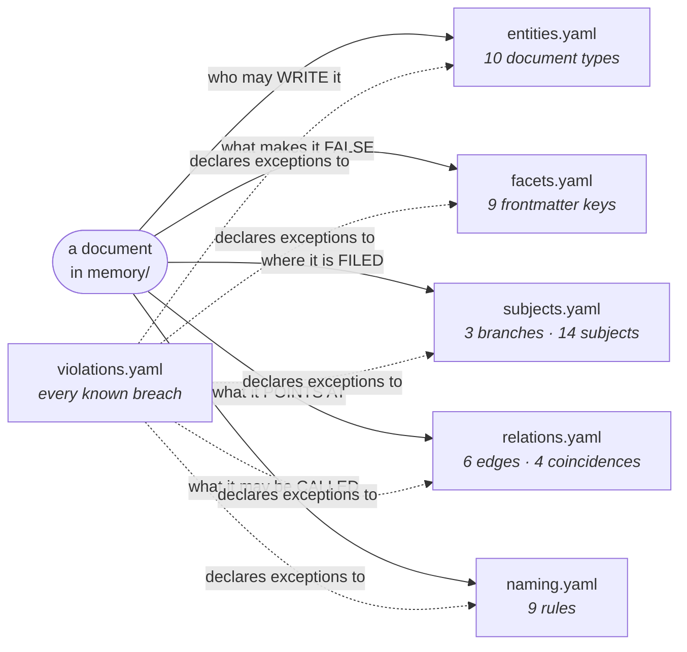
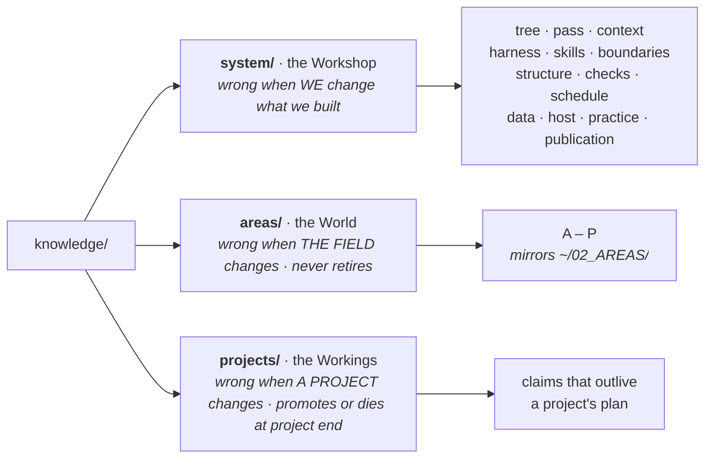
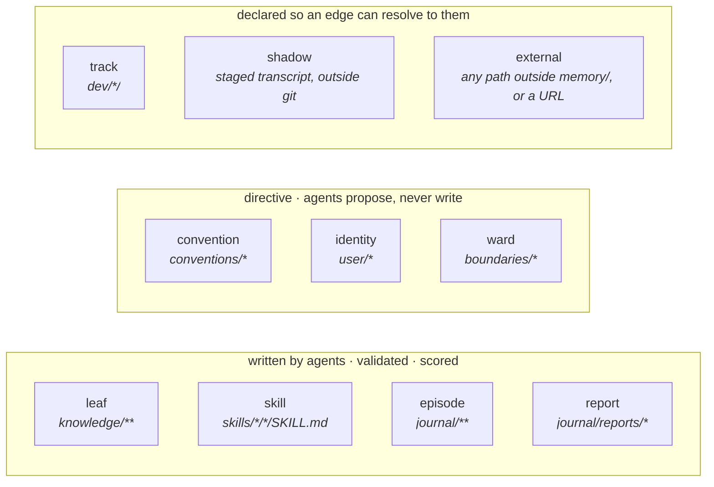
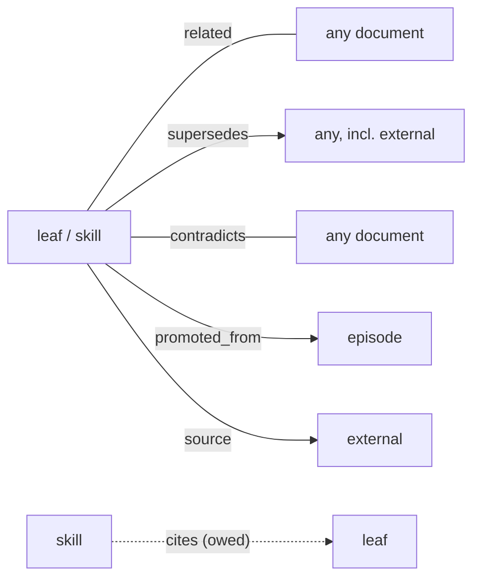
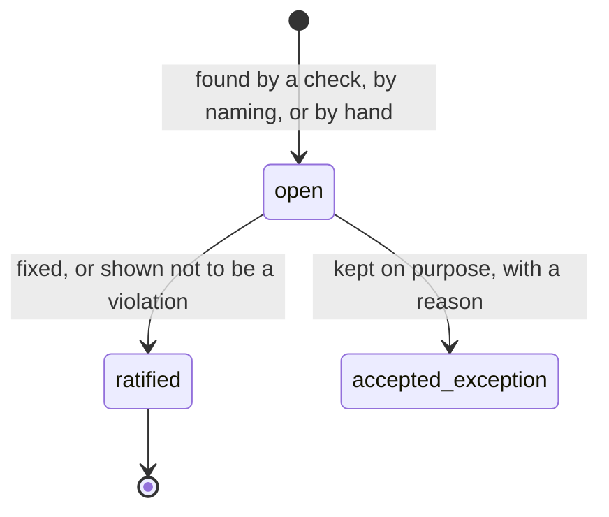

# The ontology, drawn

Human-facing: no agent loads this file. Agents route through `CONTEXT.md`,
and the code reads the six `*.yaml` registers. What follows is a picture of
those registers. **Where this page and a register disagree, the register is
right.**

---

## One question behind every register

> **What change reaches this?**

Each register asks that question about one property of a document:

`violations.yaml` is the odd one out. It holds no vocabulary, only the places
where the tree currently breaks the other five. It exists so that **a known gap
and a new breach do not look the same**: a declared violation produces a
warning, and an undeclared one fails the gate.

---

## The two cuts every entry declares

Every entry in every register sits in one cell of this grid. Writing a new field
means choosing its cell.

|  | **assertion**: a claim you can check and act on | **coincidence**: a prior that is never acted on |
|---|---|---|
| **category**: one value, rule-based, exclusive. Buys *inference* | `subject` · `trust` · `stability` · document types such as `leaf` | `area` · `same-subject` · types such as `convention` and `ward` |
| **concept**: many values, graded, cross-cutting. Buys *recognition* | — | `tags` · `scope` · `same-scope` · `same-cwd` |
| **association**: experiential links. Buys *discovery* | `related` · `supersedes` · `contradicts` · `promoted_from` · `source` · `cites` | — |

The test that separates the first two rows:

> A **category** names a place in the system you could point at.
> A **concept** names something you would search for across places.

`retrieval` is implemented in four places, so it is a concept, not a subject.
Putting concepts into the category row is the error this grid was adopted to
catch (§Why this shape).

---

## Where a document is filed: branches and subjects

Branches are split by **lifecycle**. Subjects divide `../../memory/knowledge/system/` by **which
change would make a leaf wrong**.

The subjects are **flat**: no subject contains another, and none is
grouped with others in the register.

| subject | name | a leaf here is wrong when… | places it occupies |
|---|---|---|---|
| `knowledge` | the Grimoire | the **written record** changes: filing, indexing, browsing | `memory/knowledge/` · `memory/journal/` · `config/knowledge/` |
| `consolidation` | the Vigil | the **act of writing** changes: consolidation, ranking, promotion | `engine/consolidation/` |
| `context` | the Clew | what a session carries **in and out** changes | `engine/context/` |
| `harness` | the Guises | a harness or a model changes | `engine/harness/` |
| `orchestration` | the Loom | **who does the work** changes: which familiar, model, tools and permissions a task is given | `config/orchestration/` |
| `skills` | the Apothecary | a skill or its routing changes | `memory/skills/` |
| `boundaries` | the Wards | a rule, the guard or the compile changes | `config/boundaries/` · `engine/boundaries/` |
| `structure` | the Bones | the PARA layout, its config or its CLI changes | `engine/structure/` · `config/structure/READMEs/` |
| `checks` | the Threshold | a gate, a test or the healthcheck changes. *Weakest subject, flagged for review* | `engine/checks/` |
| `schedule` | the Almanac | a timer or a unit changes | `engine/generated/` |
| `backup` | the Larder | backups, disks or recovery change | `engine/backup/` |
| `host` | the Hearth | **this machine** or its OS changes, but not a tool installed on it (that is `harness`) | `engine/host/` |
| `practice` | the Craft | `config/practice/conventions/` or `config/practice/user/` changes | `config/practice/user/` · `config/practice/conventions/` |
| `publication` | the Sign | what we show **outward** changes. *Empty until its first leaf* | — |

**The name is a mnemonic for people.** A labelling question sees only the
criteria followed by `Place(s): <places>`, composed in `ontology.py`
(`_criterion`). Metaphors are kept away from the classifier on purpose.

**Journal entries** are labelled with the same subjects plus one exit,
`areas`. An entry about the work itself (a paper, a dataset, a project) answers
`areas`, which opens a second question over A–P.

---

## Who may write a document: the ten entity types

Only the first four carry a frontmatter contract. The other six are declared so
that a pointer to them **resolves**, instead of being reported as dangling.

---

## What makes a claim false: the nine facets

| facet | values | carried by | cell |
|---|---|---|---|
| `subject` | the register's subjects | leaf · skill (from the folder) · episode · report (written) | category · assertion |
| `trust` | `quarantine` → `trial` → `trusted` · `deprecated` | leaf · skill | category · assertion. **Promotion to `trusted` is human-gated** |
| `stability` | `permanent` · `stable` · `evolving` · `volatile` | leaf | category · assertion. Sets the decay half-life |
| `origin` | `authored` · `imported` · `learned` · `derived` | leaf · skill | category · assertion |
| `authority` | `agent` · `human` | leaf · skill | category · assertion. A `human` leaf is never auto-pruned |
| `control` | `ours` · `upstream` · `shared` | leaf | category · assertion |
| `area` | `A` – `P` | leaf · skill · episode | category · coincidence |
| `scope` | path globs | leaf · skill | concept · coincidence |
| `tags` | free terms, **deliberately uncontrolled** | all four | concept · coincidence |

`tags` is left uncontrolled on principle. Making it exclusive would turn the
concept layer into a second category layer. Labelling writes `subject:` and
never `tags:`.

---

## What a document points at: edges and coincidences

| edge | direction | who writes it |
|---|---|---|
| `related` | symmetric; the pass repairs the reverse link | agent |
| `supersedes` | one-way; derives `superseded_by` | only when stated explicitly |
| `contradicts` | symmetric, unresolved until someone decides | only when stated explicitly |
| `promoted_from` | leaf → the episodes it was distilled from | the pass, which writes no other edge |
| `source` | → a URL or other material | the author |
| `cites` | skill → leaf, never the reverse | **owed**: no such key exists yet |

**Four coincidences are explicitly not edges**: `same-subject`, `same-area`,
`same-scope` and `same-cwd`. They are retrieval priors. A graph that walked them
would join almost everything to everything (`area: [B]` is on 28 of 30 leaves).

---

## What a file may be called: seven rules

| # | rule | example |
|---|---|---|
| 1 | `-` separates words, `_` separates fields | [[memory-architecture]] · `2026-09-29_slug.md` |
| 2 | a leading `_` marks a non-member of its folder | `../../memory/knowledge/_leaf-template.md` |
| 3 | case carries layer: `UPPERCASE.md` is structural, one per folder | `CONTEXT.md` · `../../memory/knowledge/INDEX.md` |
| 4 | a stem must identify itself when read alone | it appears bare in `related:` |
| 5 | a filename never encodes a facet | `reference_…` duplicates `origin: imported` |
| 6 | dates are ISO-8601 and come first when the file is an event | `2026-09-29_slug.md` |
| 7 | directories are lowercase-hyphenated; plural for collections | `skills/` · `boundaries/` |

Rule 4 is the only one a check cannot apply.

---

## How a breach moves through `violations.yaml`

Each entry records the breach, a recommendation and the paths involved. **Only
a declared entry is downgraded to a warning.** Anything undeclared fails
`familiar knowledge ontology check`.

---

## Glossary

| term | meaning here |
|---|---|
| **register** | one of the six YAML files; one row per class, rule or breach |
| **criteria** | the text that decides membership, phrased as *falsified when…* |
| **branch** | top-level split of `knowledge/` by lifecycle: `system` · `areas` · `projects` |
| **subject** | one of the subjects inside `../../memory/knowledge/system/`; also the `subject:` facet |
| **places** | the directories a subject occupies (R1g); shown to a labeller as `Place:`. A top-level directory no subject claims is under `unmapped:` with a reason, or `ontology check` fails |
| **name** | a subject's mnemonic (the Grimoire…); for people only |
| **layer** | `category` · `concept` · `association`: what a field buys (inference, recognition, discovery) |
| **column** | `assertion` (checkable, actionable) · `coincidence` (a prior, never acted on) |
| **leaf** | one claim in `knowledge/`, carrying the `../../memory/knowledge/_leaf-template.md` contract |
| **episode** | one journal entry: append-only, never scored |
| **ward** | a boundary rule: what agents may not read, write or push |
| **shadow** | a staged session transcript, kept outside git |
| **external** | the edge target meaning *outside `memory/`*. Resolves to OUTSIDE, not to nothing |

---

## Changing it

- **The registers are directive.** An agent proposes a vocabulary change into
  the session report, and the user decides. Mechanical edits that carry out a
  decision already made are allowed, and the commit says so.
- **After any edit**, run `familiar knowledge ontology check`, then
  `familiar knowledge index`, which renders subject criteria into
  `../../memory/knowledge/system/CONTEXT.md`.
- **The reasoning behind each decision** is §Why this shape below, and the
  leaves under `../../memory/knowledge/system/knowledge/` for the index, the
  journal facets and `tags:`. The ontology track that built this was deleted on
  2026-10-13 and is in git history.

---

## Why this shape

**The layering grid caught a real error.** A draft vocabulary of 2026-09-30 put
`retrieval`, `decisions` and `checks`, which are concepts, into the category
register. A concept spans places, so it cannot be exclusive: 11 of 30 leaves
(37%) were ambiguous. Under the place-vs-search test above, the corrected
vocabulary left 1 ambiguous. The grid is a design heuristic borrowed from Rosch
and Wittgenstein, not a claim about cognition. Drop it if it stops predicting.

**Content in YAML, binding in Python.** The registers (values, criteria, rules)
change when the user ratifies; `engine/knowledge/ontology.py` (what validates
what) changes with code. Different reasons to change, so different files.
Rejected: Python dicts (a typo imports and means something else, in a module the
03:30 pass imports); PyYAML (absent under the mise interpreter the timer runs);
JSON (no comments). TOML was the close second. The registers stay inside
`_miniyaml`'s subset, and the parser is not extended.

**Coincidences are never edges.** `scope`, `area`, `subject` and `cwd` overlap
feed retrieval priors only. `area: [B]` sat on 28 of 30 leaves, so an area edge
would make the graph nearly complete and carry nothing.
