# docs/

Documentation for people, in four kinds. The shape is Diátaxis: a page belongs
to the kind that matches what its reader needs, and never to two.

*A page belongs to one cell; explanation is the focal kind.*

| Folder | The reader's need | State |
|---|---|---|
| [`tutorial/`](tutorial/README.md) | learning — one end-to-end walk, on a scratch tree | **written and executed**: six steps, every output the one that came back |
| [`how-to/`](how-to/README.md) | a task — four recipes, each run once as written | **written and executed**: three end to end, one half (its audit step needs a fifth harness to exist) |
| [`reference/`](reference/README.md) | lookup — an index that links the existing documents, plus the generated maps | **written** |
| [`explanation/`](explanation/README.md) | understanding — why, with the lineage and the lore | **written**: the [lineage register](explanation/lineage.md), the [intention](explanation/intention.md), [the architecture that has no register](explanation/architecture.md), and [fourteen lore pages](explanation/README.md#the-two-rules-these-pages-obey), one per subject |

Until a page exists, the reference documents at the repository root are the
documentation, and they describe what the engine does now:

| Read | For |
|---|---|
| [`../README.md`](../README.md) | what runs on a fresh clone, and what is read-only without an install |
| [`../STRUCTURE.md`](../STRUCTURE.md) | the PARA tree, the Areas and the filing rules, generated from the example profile |
| [`../STORAGE-MODEL.md`](../STORAGE-MODEL.md) | authority, tiers, backup repos, flows and the storage rules |
| [`../engine/README.md`](../engine/README.md) | the engine's directories, one line each |
| [`../memory/knowledge/INDEX.md`](../memory/knowledge/INDEX.md) | every knowledge leaf that ships, one line each |

## What is not here

The agent-facing entry points (`CONTEXT.md`, `AGENTS.md`, `CLAUDE.md`) are not
documentation: they exist to route a session, and they are written for a reader
that pays for every line. The maintainer's reference for this machine — the
journal, the practice files, the track notes — does not travel with this tree at
all, by design; see [`../STORAGE-MODEL.md`](../STORAGE-MODEL.md).

`assets/` holds figures and the scripts that draw them:
[`assets/route-cost-chart.py`](assets/route-cost-chart.py) draws
[`assets/route-cost-chart.png`](assets/route-cost-chart.png).

**The mythic names** the pages use (the Grimoire, the Vigil, the Wards) are
mnemonics, claiming no tradition. Each is introduced where a mechanism needs a
handle, and [`explanation/lineage.md`](explanation/lineage.md) records what
lineage *is* claimed and where every analogy stops.
