# The architecture that has no register

Three figures, hand-drawn, for the three relations no register holds: where a
thing goes, which copy is authoritative, and what leaves a tier. The generated
maps — the package order, the subjects, the boundaries, the schedule, the pass —
are in [the reference page](../reference/maps.md).

**Each node declares what it stands for.** Above every figure below an HTML
comment holds a `%% path:` line for a file that travels or a `%% para:` line for a PARA folder,
and `familiar structure maps --check` fails on a declaration whose path does not
exist or whose folder the master config does not declare. A hand-drawn figure
cannot be generated from a register, but it can be made to point at something
real.

## 1 · Where a thing goes

The filing decision, in full: one question per destination, and anything
undecided stays in the inbox.

<!--
%% path: STRUCTURE.md
%% para: 00_INBOX
%% para: 01_PROJECTS
%% para: 02_AREAS
%% para: 03_ZETTEL
%% para: 04_RESOURCES
%% para: 05_ARCHIVES
%% para: 06_SYSTEM
-->

*The filing decision: five questions in turn, each yes a PARA folder, the rest stays in the inbox.*

Source: [`STRUCTURE.md`](../../STRUCTURE.md) §The filing decision — the table
this figure draws. Limit: **no gate checks a filing.** Nothing measures whether a
note landed in the right folder, so this figure states the intent, not a
mechanism; the one mechanical rule it does carry is that capture lands in
`00_INBOX` first, which `familiar host capture` enforces by writing there.

## 2 · Which copy is authoritative

One authority per path, decided by where the path is rather than by a table: the
`05_ARCHIVES-EXTERNAL/` prefix means the archive disk owns it, and everything
else is the working machine's.

<!--
%% path: STORAGE-MODEL.md
%% para: 05_ARCHIVES
%% para: 05_ARCHIVES-EXTERNAL
-->

*Four tiers: the working machine and the archive disk are authoritative, staging and the repositories are not.*

Source: [`STORAGE-MODEL.md`](../../STORAGE-MODEL.md) §2 (authority) and §5
(archiving is a two-step operation). Limit: the arrow from the working machine
to the repositories is a *copy*, not a move, and a copy is only as good as a
restore — the procedure, and the state of this machine's repositories, are
[the how-to](../how-to/recover-from-backup.md) and
[the Larder](lore/backup.md). The disk is authoritative for what is on it
whether or not it is attached, which is why the archive tier has no
active/archived distinction inside it.

## 3 · What leaves a tier, and when

Three tiers, one direction: a session lands in the journal, the nightly pass
distils it into knowledge, and what stops being read is archived.

<!--
%% withheld: memory/journal
%% path: memory/knowledge
%% path: memory/knowledge/system/consolidation/consolidation-cycle.md
%% para: 05_ARCHIVES
-->

*A session lands in the journal, the nightly pass distils it, disuse sends it to staging, and the flush to the archive disk is the one step that crosses a repo.*

Source: [`consolidation-cycle.md`](../../memory/knowledge/system/consolidation/consolidation-cycle.md)
for the pass's direction, and the registry for what a session contributes. The
journal does not travel with this tree — it is the session record, and the export
omits it whole — so the leftmost tier in this figure is one a reader here cannot
open. Limit:
the figure shows direction and not rate — no register holds how long an item
stays in a tier, and the demotion step is a proposal the user acts on rather than
a timer. Deletion is likewise a human action; nothing here removes a leaf on its
own.

## Why these are hand-written, and what keeps them true

A figure drawn from a register cannot drift from it, so the five generated maps
are generated. These three have no register to draw from: the filing decision is
a set of questions, authority is a path convention, and displacement is a
direction of travel. Drawing them as SVG with its HTML source in `docs/assets/figures/`, next to the prose that
says what they leave out, is the honest form — a picture in a document nobody
regenerates is what `VISUAL-ARCHITECTURE.md` was.

What keeps them from rotting is the declaration check: every figure names the paths or
folders it draws, and the gate fails when one stops existing. That is a weaker guarantee
than generation, and it is stated rather than implied.
