# Lineage — borrowed ideas, and where each one stops

A register of the ideas this system took from elsewhere. Every row names its
source, the claim borrowed, the point at which the analogy stops holding, and
how strong the link is. The limit column is not a hedge: an analogy is a model,
and the sentence that gives its boundary is the part that tells a reader when to
stop reaching for it.

**Naming a source is not the same as descending from it.** Three of the links
below are stated in this tree — a folder is named for one, a document names
another — and the rest are inferences from a structure that resembles a
published one. The Difference column says which.

*Each source with the idea taken from it, where the analogy stops, and the strength of the link.*

| System element | Source | The claim borrowed | Where the analogy stops | Link |
|---|---|---|---|---|
| the folder layout: `01_PROJECTS`, `02_AREAS`, `04_RESOURCES` | Forte, Tiago. *The PARA Method* (2023). <https://www.buildingasecondbrain.com/para> | Four buckets ordered by **actionability** rather than by topic, so filing asks how soon something is needed and never what it is about | Forte's method has four: Projects, Areas, Resources, Archives. Three of those are here, a Zettelkasten sits between Areas and Resources, and no Archives folder exists at the top level — a project's leftovers go to an Area or are deleted | named source; the correspondence is **partial** |
| the Zettelkasten: `03_ZETTEL` | Luhmann, Niklas. "Communicating with Slip Boxes" (1981; English translation at <https://luhmann.surge.sh/communicating-with-slip-boxes>) | Notes as a growing network addressed by identifier, read by following references rather than by browsing a hierarchy | Luhmann's was one person's paper index built over forty years, and his method is a way of *reading* it. Here it is one PARA folder of markdown, and retrieval is an index built by the engine — the folder keeps the name and the filing posture, not the practice | named source for the **name**; the method is not claimed |
| the nightly pass: replay, consolidate, downscale | Tononi, Giulio, & Cirelli, Chiara. "Sleep and synaptic homeostasis: a hypothesis." *Brain Research Bulletin* 62(2):143–150 (2003). doi:10.1016/j.brainresbull.2003.09.004 | A consolidation step that **weakens** what it keeps, rather than only strengthening it — a night's work is as much subtraction as addition | The hypothesis is about synaptic weights in a sleeping brain. The pass is file operations over a text corpus on a timer: nothing in it is tired, and "sleep" is the clock rather than a process | named source for the **downscale** half; the *replay* half is uncited (see Dropped) |
| the fast journal and the slow knowledge tree | McClelland, James L., McNaughton, Bruce L., & O'Reilly, Randall C. "Why there are complementary learning systems in the hippocampus and neocortex." *Psychological Review* 102(3):419–457 (1995). <https://psycnet.apa.org/record/1995-42327-001> | Two stores with different jobs: one fast and pattern-separated for the episode, one slow and integrative for what outlives it, joined by a promotion path | The paper's problem is catastrophic interference inside a network. Here the two stores are two directories, the promotion is a human-gated write, and the "interference" avoided is a reader's attention rather than a weight matrix | **inference from the structure** — no file in this tree names the paper |
| exponential decay in the ranker | Ebbinghaus, Hermann. *Memory: A Contribution to Experimental Psychology* (1885; translation 1913, <https://archive.org/details/memorycontributi00ebbiuoft>) | Retention falls with time since last use, steepest at first | Ebbinghaus measured one person's nonsense syllables. The half-lives in the ranker are **chosen constants per compartment** — 180 days for recency — set by judgment, never fitted to a curve | **weak**: exponential decay is generic, and no claim here rests on it |
| approximate nearest-neighbor search, as a considered fallback | Dasgupta, Sanjoy, Stevens, Charles F., & Navlakha, Saket. "A neural algorithm for a fundamental computing problem." *Science* 358(6364):793–796 (2017). doi:10.1126/science.aam9868 | A fly's olfactory circuit implements locality-sensitive hashing over sparse high-dimensional input: similarity search with **no model to run** | The paper's contribution is the algorithm; this tree cited it and then declined it. At journal scale lexical search was judged simpler, so the fly informs a decision that was *not* taken | named source; the rejection is recorded in [`../../memory/knowledge/system/consolidation/prior-art-memory-systems.md`](../../memory/knowledge/system/consolidation/prior-art-memory-systems.md) |
| the documentation's own shape | Procida, Daniele. *Diátaxis*. <https://diataxis.fr/> | Four kinds of documentation — tutorial, how-to, reference, explanation — separated by what the reader needs rather than by topic | The framework's separation is stricter than this tree's. A lore page carries explanation *and* the mechanism it names, because a register has to be introduced somewhere a mechanism is already under discussion | named source; the brief names it |
| the mythic names: the Grimoire, the Vigil, the Wards, … | none, deliberately | Nothing. The register is **mnemonic**: a name is a handle for a mechanism, chosen for sound and for what it makes easy to remember | A name here asserts nothing about the tradition its word comes from. Read the claim columns in [`../../memory/knowledge/system/publication/glossary.md`](../../memory/knowledge/system/publication/glossary.md), which is generated from the register and cannot drift from it | **no source claimed** (user, 2026-10-14) |

## Confidence labels

Two forms, and a row says which it uses:

- **named source** — the citation resolves and states the claim. What may still
  be weak is the *link*: naming a paper does not make a design descend from it.
- **inference from the structure** — nothing in this tree says the source was
  consulted. The observable is that two structures resemble each other, and the
  counterfactual is a document that names it.

## Dropped

A candidate whose citation does not resolve is not a row. Two are dropped here,
and each is dropped rather than muted because an uncited claim and a wrongly
cited one fail differently:

- **Hippocampal replay** (the *replay* half of the nightly pass). The candidate
  was Wilson & McNaughton's 1994 *Journal of Neuroscience* report. The DOI
  recalled for it returns 404, the journal's page refuses this fetcher, and no
  copy of the citation exists in this tree. The pass's vocabulary claims the
  *weakening* half only, which has a source above.
- **The forgetting curve as a *design* input** (row 5). The source resolves; the
  claim that the ranker's constants follow it does not. Keeping the row with a
  weak label is the honest form, so it is not dropped — only its status as a
  lineage is refused.

## Honest limits

**This register records links, not influences.** Seven of its eight rows are
claims about resemblance, and the difference between "named after" and "designed
from" is exactly the one a register like this exists to keep visible. A reader
who wants the design's reasons should read the mechanism's own page in
[`lore/`](README.md); this file says where an idea came from, not why it was
chosen.

**It is not exhaustive.** It covers the candidates that were recorded while
building, which is a record of what someone thought to write down. A design
decision with no note beside it has no row here, and that absence is not
evidence that the decision was original.

**Still open.** The rows are verified against the sources as of 2026-10-14; a
DOI that stops resolving is a broken row rather than a broken claim, and the fix
is to re-verify rather than to delete.
