# the Larder — stores laid by against a lean season

| | |
|---|---|
| subject | `backup` |
| falsified when | backups, disks or recovery change |
| occupies | `engine/backup`, `config/backup` |

**The name.** A larder is stores laid by, and the register counts three of them
— the mirror, the cellar, the archive disk. The word also carries the right
expectation, which is that a larder is for a season that has not arrived yet: it
is judged by what it can be asked for, not by what is in it.

## The mechanism

Repositories of restic backups over the tree, plus archive disks for the tier
that is kept below the working floor. The system's storage rule decides what
belongs here: something is worth keeping if it **cannot be re-acquired**, so the
question a larder answers is not "is this big" but "could this be got again".

*the larder: restic repositories over the tree, and the restore path that is the point of it.*

## The design choice, and why

**A backup nobody restored is a hypothesis.** The valuable artefact is the
restore path, and the recipe for it is written down as a procedure rather than a
claim — see [the Spellbook](../../how-to/README.md).

**Degraded is stated, not glossed.** The leaf for this subject records the
current state as degraded, with the reason, and this page does not improve on it.
A published page claiming that backups work would be a claim the system does not
measure, and the register's own rule for the lore — never promise what the system
does not measure — applies to the plain pages too.

## Lineage

**No source claimed.** The tool is chosen, not invented: restic does the
content-addressed storage, and the design contributions here are the
re-acquirability rule and the three-tier split.

**Where the analogy stops.** A larder is filled by habit — you lay by what you
will want. These repositories are filled by a timer and a rule, and a larder with
a broken shelf is a room with food in it, not a larder. The degraded state is
exactly that distinction, which is why it is on this page rather than in a
footnote.

**Leaves — not here.** `memory/knowledge/system/backup/` holds the repositories,
the disks and the current state, and it is this machine's own operational record:
the export omits it. The design half does travel, in
[`STORAGE-MODEL.md`](../../../STORAGE-MODEL.md) — authority, tiers, the
repositories and how their boundaries are drawn.
