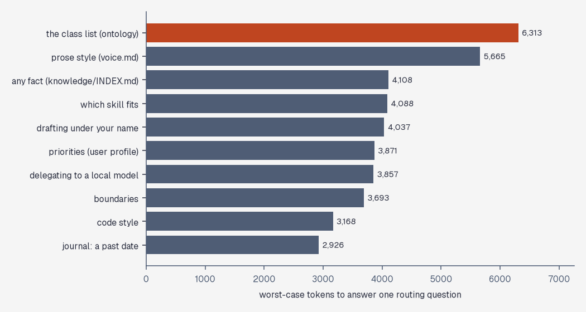

# the Clew — what a session carries in and out

| | |
|---|---|
| subject | `context` |
| falsified when | what a session carries **in and out** changes |
| occupies | `engine/context` |

**The name.** A clew is a ball of thread, and the way back out of a labyrinth —
the origin of the word *clue*. The register uses it for the layer that decides
what a session is handed on the way in and what it leaves behind on the way out,
because the useful part of the image is not the thread but the *following*.

## The mechanism

A session begins with a fixed budget of text already loaded — the always-on
entry point and whatever it points to — and gets everything else by asking.
Retrieval is a tool the agent calls, over the knowledge tree and the journal,
rather than prose injected in advance. `engine/context` holds the navigation and
the measurement: what a harness costs, what a route costs, and what a pointer is
worth.

*the clew: what a session carries in, and what it must leave behind.*

## The design choice, and why

**Pointers are measured, not assumed.** A staged corpus of real sessions was
scored for how often a session actually follows a pointer it is given. The result
set the always-on decision, and it is the reason the entry point stops at one
index level: a second level is cheaper to write and, by the same measurement,
mostly not read.

**Cost is audited per route.** The question "what does it cost to answer this
kind of question" has a number, and a figure is drawn from it rather than
asserted:

The script that draws it, [`../assets/route-cost-chart.py`](../../assets/route-cost-chart.py),
holds the figures.

## Lineage

**No source claimed** for the name. The measurement has no ancestor in this tree
either: the follow-rate corpus is this machine's, and its conclusion is bound to
the harnesses measured — a different harness, or a model with a different
appetite for reading, would move it.

**Where the analogy stops.** The thread out of the labyrinth leads somewhere by
itself; a clew here is a pointer plus a budget, and it hands the reader nothing
unless the reader follows. That is the finding, not the failure: the design
assumes the following happens *sometimes*, and spends accordingly.

**Leaves.** [`memory/knowledge/system/context/`](../../../memory/knowledge/system/context/)
— the budget and its audit, and the follow-rate measurement with the decision it
informs.
