# the Guises — the forms a familiar takes

| | |
|---|---|
| subject | `harness` |
| falsified when | a harness or a model changes |
| occupies | `engine/harness` |

**The name.** One spirit, several bodies. The register uses a guise for the shape
a familiar wears into a room, because the thing being named is an *entry point*:
the same tree, the same files, the same boundaries, entered by programs with
different conventions for saying so.

## The mechanism

Five harnesses — Claude Code, `pi`, `hermes`, `opencode` and `codex` — plus the
local models they can reach, the MCP servers that give them retrieval, and the
output filter that keeps their answers small enough to read. `engine/harness`
holds what is known about each: its hooks, its skills mechanism, its settings,
its traps.

The five are not equally integrated, and the roster says so rather than implying
otherwise. Codex is audited for what it costs and wired to nothing: no always-on
payload, no boundary hook, no capture ([codex](../../../memory/knowledge/system/harness/codex.md)).
It is in `harnesses.py`'s `ALL` because the audit measures it, which is a weaker
claim than being an entry point.

*the guises: one memory base, reached by every harness at the same path.*

## The design choice, and why

**The harness is replaceable; the tree is not.** Everything the system knows
lives in files a harness reads, so a new harness is an entry point rather than a
migration — and it is a code change, because the surfaces are yielded from
`engine/context/l1.py` rather than listed in a config file
([the recipe](../../how-to/add-a-harness.md)). That is the reason for the
register's plainness rule *inside* the
code: module docstrings carry the mythic name with a plain gloss on line one, and
paths are never renamed for the mythos. A path here is an interface — compiled
into boundary rules, units and classifications — so it is the one thing that must
stay boring.

**Differences are recorded, not averaged.** Each page names what that harness
does differently, because a common denominator would be a false statement about
all four. The one shared question — how to split work across several agents — is
marked open rather than answered.

## Lineage

**No source claimed** for the name or the mechanism: the register is mnemonic.
The relevant lineage is technical rather than conceptual and lives in the leaves
— each harness's own conventions, quoted from its documentation.

**Where the analogy stops.** "One spirit" is a figure of speech, and the pages
exist because the bodies differ. A guise is not a translation layer: each harness
reaches the same files through its own mechanism, and a hook that works in one is
not evidence for another.

**Leaves.** [`memory/knowledge/system/harness/`](../../../memory/knowledge/system/harness/)
— one page per harness, plus the MCP wiring, the local models, the output filter,
and the delegation question that is still open.
