# the Grimoire — the written record

| | |
|---|---|
| subject | `knowledge` |
| falsified when | the written record changes: filing, indexing, browsing |
| occupies | `memory/knowledge`, `engine/knowledge`, `memory/journal`, `config/knowledge` |

**The name.** A grimoire is a book of practice, and the register's gloss adds the
one thing that makes it the right handle here: it is the book **that writes and
maintains itself**. That second half is a mechanism, not a boast — the index and
the glossary are generated from registers, so a rebuilt page cannot contradict
the file it was derived from.

## The mechanism

Two trees under one name. `memory/journal` is the private record, written for
oneself and in the order it happened. `memory/knowledge` is the other direction:
one fact per leaf, filed by subject, carrying frontmatter that says what the leaf
is worth — its authority, its trust level, when it was last verified, its
scope. A leaf is not a note; it is a claim with its standing attached, which is
what lets a later reader decide whether to act on it.

`engine/knowledge` reads the tree: the index, the search, the register checkers,
the glossary. `config/knowledge` holds the vocabulary those readers resolve
against.

*the grimoire: the routing table narrows to the one subject, then the one leaf.*

## The design choice, and why

**One level of disclosure, and it is generated.** `memory/knowledge/INDEX.md` is
the only index between the agent entry point and a leaf — every fact, one line
each, with the trigger terms a session matches against. A second index level was
refused: it would be a second place for the truth to live, and a model that has
read the index has already routed.

The alternative it replaces is the blanket injection — put everything always-on
and let the reader sort it out. That option was measured and lost: the follow
rate over the staged corpus did not justify its cost (see
[the Clew](context.md)).

**Frontmatter is the standing, not decoration.** `trust`, `authority`,
`last_verified` and `scope` are what a reader must not have to infer.

## Lineage

The register's gloss — a book that maintains itself — is **its own**, and the
Zettelkasten row in the [lineage register](../lineage.md) belongs to `03_ZETTEL`
rather than to this subject: the folder kept the name and the filing posture, not
the practice.

**Where the analogy stops.** "Writes itself" is true of the derived pages and
false of the facts. Every claim enters through a human-gated promotion, and the
generated files are the only ones the engine may author.

**Leaves.** [`memory/knowledge/system/knowledge/`](../../../memory/knowledge/system/knowledge/)
— the tree's architecture, the index, both directions, browsing, and the filing
test that separates a claim from a procedure.
