# the Craft — conventions and the person they are for

| | |
|---|---|
| subject | `practice` |
| falsified when | `config/practice/conventions/` or `config/practice/user/` changes |
| occupies | `config/practice` |

**The name.** The craft is what the practitioner knows: not the tools and not the
store, but the way the work is done. The register gives no gloss for this name,
so the reading here is this page's own — and it carries the subject's real
distinction, which is that this is the only place a *person* is described rather
than a system.

## The mechanism

Two stores, and the split is the whole design. `conventions/` holds rules for the
system and for anything writing into it — how a document reads, how a claim is
made, what may be asserted without a source. `user/` holds facts about the person
the system serves: how they think, what they are working on, what to ask them and
what not to.

**The conventions travel; the person does not.** Both are directives, read by
agents and changed by the user, but the publication classification treats them
differently. `conventions/` is public: the rules ship as written. `user/` is
omitted, and the published tree carries placeholders in its place that say what
each file is for and nothing about whom. That is why
[the Intention](../intention.md) quotes the mission rather than linking it.

*the craft: the user's conventions, loaded in full by each harness.*

## The design choice, and why

**A rule for everyone is not a fact about someone.** Keeping them in one folder
would make "the user prefers terse answers" indistinguishable from "documents are
written in American English", and the two have different authority: one can be
overruled by the person it describes, the other is the system's standard.

**The voice register is two documents, not one.** What a document in this
repository should sound like, and what writing *under the user's name* should
sound like, are different jobs with different failure modes — the second one's
worst failure is an invented citation, and it is a separate file for that reason.

**Filing is decided by a test, not by feel.** A leaf states which store owns a
thing, because the same fact filed in the wrong place is found by nobody.

## Lineage

**No source claimed.** The conventions are written here; where they borrow a
common standard — one statement per sentence, sources over assertions — that is
stated at the rule rather than in this register.

**Where the analogy stops.** A craft implies long practice by one person. These
files are instructions *to* a system about how to behave toward a person, which is
the inverse relation, and the one thing they cannot do is verify that a document
follows them — no gate reads the voice.

**Leaves.** [`memory/knowledge/system/practice/`](../../../memory/knowledge/system/practice/)
— the filing test for a fact that could belong to either store.
