# the Sign — what is shown outward

| | |
|---|---|
| subject | `publication` |
| falsified when | what is shown **outward** changes |
| occupies | `docs`, `engine/publication` |

**The name.** A sign marks a place and says what is inside it. The register gives
no gloss for this name, so the reading is this page's own — and the useful part
is the asymmetry: a sign is what a stranger sees, which is a fact about the
boundary rather than about the contents.

## The mechanism

Two halves that must not drift. The **classification** says, for every tracked
path, whether it travels and why — a rule or an explicit entry, checked by an
audit that fails on a path with no answer and on a rule that matches nothing. The
**export** builds the published tree from that answer, runs the same gate on the
result, and refuses to write if the tree it is about to publish is not sound.
A scanner then looks for the things that must not leave — a real name, a real
path, an instance string — and every hit must be declared, with a count.

*the sign: the private tree crosses the gates into the generated public repository.*

## The design choice, and why

**Publication is a property of a path, declared once.** The alternative — a
publish script holding a list of exclusions — drifts the moment a folder is
added. Here a new path with no classification fails the audit, so the decision is
forced at the moment the path is created rather than at the moment someone
publishes.

**The tree that ships is gate-checked, not assumed.** The export runs the gate
*inside* the tree it built, so a defect that only exists in the assembled output
is caught by the assembly rather than by a reader. Two classes of check are
declared instance-only and counted as skipped there — the difference between a
skip that is declared and a check that quietly measures nothing is the thing this
whole subject exists to keep visible.

**A silence is not a clean scan.** The scanner reports hits, declarations and
stale declarations separately: a count raised to silence a new occurrence is the
edit the register of exceptions exists to prevent.

## Lineage

[One row](../lineage.md) is about this folder rather than this subject: the
documentation's four-way shape is Diátaxis, borrowed and then loosened — a lore
page here carries explanation and a mechanism together, which the framework
separates.

**Where the analogy stops.** A sign is a claim staked at a boundary; the
mechanism is a classification file, an exporter and a scanner, and the name on
the sign is not evidence about the contents. That is precisely what the scan and
the gate are for: the sign says what should be outside, and the checks are what
make the claim testable.

**Leaves.** [`memory/knowledge/system/publication/`](../../../memory/knowledge/system/publication/)
— the generated subject glossary, which is derived from the register and
therefore cannot disagree with it.
