# the Almanac — what is done when

| | |
|---|---|
| subject | `schedule` |
| falsified when | a timer or a unit changes |
| occupies | `engine/schedule`, `config/schedule` |

**The name.** An almanac is a calendar of what happens when, computed from rules
rather than remembered. The register's naming rule keeps the mythos out of the
part the operating system owns — unit names stay functional, because they are the
OS's interface — and puts it in the description instead.

## The mechanism

Timers for the work that has to happen without anyone deciding it should: the
nightly pass, the periodic checks. Each unit declares when it fires, what it
runs, and what it is allowed to write. The unattended writer is the interesting
case, and it is the same problem the [Vigil](consolidation.md) solves one level
down: a process nobody is watching may only write what a rule published in
advance permits.

*the almanac: one day's scheduled units, fires and sources.*

## The design choice, and why

**Names functional, descriptions mythic.** Renaming a unit would break the one
part of this system that lives in the OS rather than in the tree, and the value
of the name is in reading the log, not in the filename.

**Generated artifacts are declared, not discovered.** Anything a timer writes is
a file the healthcheck knows about, so a stale generated file is a *report*
rather than a surprise. The two failure modes are a timer that never fired and a
generated file nobody rebuilt; both are checkable, and both have been observed
here.

## Lineage

**No source claimed.** A timer is a timer; the contribution is the rule about
what an unattended writer may touch, which is shared with the consolidation pass
rather than descended from a published design.

**Where the analogy stops.** An almanac predicts. These units are a handful of
timers, and a unit that has never fired is untested rather than reliable — the
log is the evidence, and the absence of a failure is not the presence of a
guarantee.

**Leaves.** [`memory/knowledge/system/schedule/`](../../../memory/knowledge/system/schedule/)
— every unattended process, when it runs, and what it may write.
