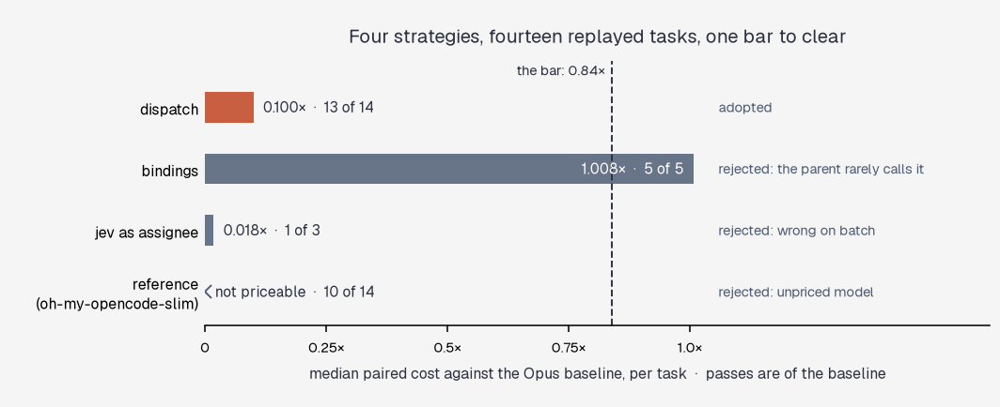

# Orchestration — how work gets a model

**The system decides which model does each piece of work, from a written
catalogue and a written policy — and it measures whether that decision paid.**
Nothing here is enabled because it sounds plausible. This page explains the
mechanism and what the measurement found. The rules themselves live in
`config/orchestration/`; the reasoning lives in the knowledge leaves linked at
the end.

## The problem it answers

Orchestration used to be three answers in three places, none of them shared: an
opencode prompt, Claude Code's agent files, hermes's delegation block. Two costs
followed. Every new arrangement had to be re-learned from scratch, and nobody
could say whether delegating to a cheaper model helped or hurt.

The replacement is one catalogue of every callable model, one profile saying what
this machine may reach, one policy naming which models are good enough for which
kind of work — and an evaluation that replays real tasks to check the policy.

## The shape of it

*The catalogue and the profile feed one policy; dispatch reads the policy and names one model per item.*

The loop at the bottom is the point. A strategy becomes a default for a class of
work only when the eval says it passes at least as often as the Opus baseline
**and** costs at most 0.84× as much — or passes two more tasks outright.

## The four moves

| move | when it fires | who decides | what it looks like |
|---|---|---|---|
| **dispatch** | at planning, once per item of a `SPECS.md` | the item's class, from `selection.yaml` | the plan prints the declared model and the suggested one |
| **bindings** | during a session, when a tool is called | a declared mapping, `tool:read` → a model | the child returns a `path:line "quote"` the parent can check |
| **pi-agent** | by hand, for a bulk read | the role's own frontmatter | one line per child in `delegations.jsonl` |
| **the ask link** | when a wrapped delegation trips a permission floor | written rules, not a model | allowed with a reason logged, or you are asked |

The first three answer *who runs this*. The fourth answers a different question —
*does this need your attention?* — and it is the reason a delegated call does not
stop at an approval prompt.

*A delegated call is allowed only when a wrapper floor applies and every statement is a delegation.*

A rule in `read-write.yaml` cannot silence these asks. The permission package
floors an unparsed wrapper to `ask` over any `allow`, so the only way to answer
one is a link the package consults — and a link may grant or defer, never widen
what a rule denies.

## What it costs, and what it saves

Fourteen tasks replayed from this repository's own history, each judged by a
verifier written from the task text. Bars are the median paired cost against the
Opus baseline.

| strategy | verdict | the numbers |
|---|---|---|
| **dispatch** | **adopted**, in all four classes | 13 vs 12 passes; **0.100×** the cost. `batch` 0.041×, `web` 0.037×, `retrieval` 0.096×, `coding` 0.212× |
| bindings | rejected as tested | pass parity, 1.008× the cost. The parent called a bound tool in 4 of 9 cells |
| Jev as assignee | rejected by measurement | 1 vs 3 passes, reproduced on the rerun |
| oh-my-opencode-slim | rejected as installed | 10 vs 12 passes; its own subagent lanes could not start |

**What dispatch actually buys.** The same work, at about a tenth of the frontier
cost, with no loss in pass rate. Two mechanisms produced the saving and both
cleared the bar: three coding tasks ran on `deepseek-flash` (a CN vendor's model
reading this repository's code, allowed under the `private` profile), and three
ran on the models their items had declared.

**What it does not buy.** Tokens rose to 1.49× the baseline, because a cheaper
model explores more. Wall-clock time rose 1.4–1.7× for the same reason. Neither
is in the rule: the rule compares cost, since moving to a cheaper tier is the
goal.

**How much of this is signal.** The run-to-run noise floor is 0.078 — the median
difference between two attempts at the same task, over the cells that have a
clean repeat. The bar sits at 1 − 2 × that, which is where 0.84 comes from. The
same estimate is 0.119 if the three reruns that followed a bug fix are counted,
and the bar would then be 0.76; nothing above depends on which is used. No arm
passed a sign test, and the partial arms could not have: with five pairs, the
smallest possible p is 0.06. These are default settings, not laws.

## When an item fails

An assignment is frozen at planning time, so a failure needs a path out. The
wrapper prints the next rung after every failed verify.

*After two failed verifies the wrapper walks effort, then tier, then hands the decision to you.*

Every rung is a **re-dispatch with context**, never a model switch inside a
running session: switching mid-task forfeits the prompt cache and changes the
model recorded against the item. Effort goes first because it is the cheapest
dial there is — the same model, more output tokens, nothing else changed.

## What is already guarded

- **Nothing is borrowed silently.** A model whose vendor has no key in the active
  profile is unavailable; reaching for it needs an explicit approval that is
  logged.
- **A privacy axis is enforced, not documented.** Egress is a field in the
  catalogue, so "this content may not go to a remote model" is a filter.
- **The evaluation cannot corrupt the machine.** Each cell runs in a copy of the
  repository at its base commit, under `bubblewrap`: the live checkout is
  read-only, and `.git`, `dev/` and `memory/journal` are emptied — they hold the
  answers.
- **Every choice leaves a record.** Labels, delegations and permission decisions
  are three append-only logs, and the leaves name the join key between them.

## What the future might bring

None of these is measured yet. Each says what has to happen first.

| improvement | what it would buy | first |
|---|---|---|
| **delegation on a count trigger** | the parent reads fewer files itself: the trigger fires on 28.7% of turns, and pays if uptake ≥ 50% at ≥ 5× compression | 30 trigger fires in normal work |
| **the labels becoming thresholds** | selection by measured pass rate, not by benchmark percentile | 30 items verified through the wrapper |
| **Jev judging the remaining wrapper asks** | fewer interruptions outside delegations | a decision, and evidence it beats a plain rule |
| **local models reading local files** | nothing leaves the machine, and the cost is electricity | the ~6-month hardware upgrade |
| **`jit-agents` (generated specialisation)** | a task-specific prompt instead of a routing table | an arm in the eval; never run |
| **cross-harness generation** | one source, three generated configs — opencode and Claude Code get the same policy | pi measured first, which is done |
| **automatic quota fallback** | work continues when the Claude window closes | not yet: 0 of 73 cells were refused |

## Notes for a future track

- **The eval set has no high-difficulty `edit` task**, so the tier that selects
  the frontier model has never been exercised as a dispatch arm. The coding
  savings are all in the cheap tier.
- **The reference arm deserves a re-run.** Its subagent lanes could not start in
  round 1, so the arm measured an orchestrator working alone. The lane defect is
  fixed.
- **`batch-o4b-replay` in the reference arm never wrote its output file**, in
  three attempts. One attempt is explained by a harness flag; two are not.
- **The cheapest bound call halved its cell's cost** — $0.0255 against the
  baseline's $0.0525 — but the parent called a bound tool in only 4 of 9 cells.
  Uptake, not unit cost, is what the arm is missing.
- **`used` in the delegation log is a heuristic with a stated floor**: a result
  the parent relied on silently counts as unused.
- **The trigger is a counted population.** Changing a threshold is a
  re-calibration, so it is replayed and recorded rather than tuned.
- **The knowledge index is nearly full** — about 1,940 of 2,000 tokens across 37
  leaves. The recorded procedure is to split it per branch, not to raise the
  number.
- **The quota calibration is unmeasured**: what a Claude subscription's window
  actually allows per day, against a known workload.
- **The wrapper asks in the permission log** (667 of 715 in six weeks) are mostly
  shapes no rule can answer. A model could judge some of them; that is a decision
  with costs of its own.

## Where the detail lives

| question | leaf |
|---|---|
| what was tried, and every verdict with its evidence | `memory/knowledge/system/orchestration/orchestrators.md` |
| the catalogue, profiles, tiers, the dispatch contract, commands | `memory/knowledge/system/orchestration/the-loom.md` |
| running the eval, and how to read a row | `memory/knowledge/system/orchestration/orchestration-eval.md` |
| the logs, the ask link, and the `rtk` rewrite | `memory/knowledge/system/orchestration/delegation-and-asks.md` |
| the permission rules themselves | `memory/knowledge/system/boundaries/boundaries.md` |
