# Add a boundary

A boundary is a rule about one path and one kind of operation. It is written once
in `config/boundaries/`, compiled to every surface that can enforce or state it,
and enforced where a tool call passes a harness. Four steps, and the last one is
what proves the rule bites.

`config/boundaries/` is **directive**: you write the rule. An agent proposes one
and stops, because a boundary an agent can edit is not a boundary.



*One rule, compiled once, becomes four surfaces: two enforce, two only state it.*

## Run it somewhere scratch first

Two of the compiled targets are files under `$HOME` — the Pi permission policy
and the hermes memory block — and their paths are resolved when the compiler
runs, not when the tree was cloned. So run the compiler with `HOME` already
moved:

```console
$ export HOME=/tmp/ward/home
$ git clone <repo> $HOME/06_SYSTEM
$ cd $HOME/06_SYSTEM
```

Ask where it will write before it writes:

```console
$ python3 -c "import sys; sys.path[:0]=['engine','engine/boundaries']; import _boundaries as b; print(b.JSON_TARGET); print(b.PI_PERMISSION_CONFIG); print(b.HERMES_MEMORY)"
/tmp/ward/home/06_SYSTEM/config/boundaries/boundaries.json
/tmp/ward/home/.pi/agent/extensions/pi-permission-system/config.json
/tmp/ward/home/.hermes/memories/MEMORY.md
```

**What the export is protecting you from.** Run the same compiler from a scratch
tree with your real `$HOME` still in place and it splices the scratch tree's
rules into your own `~/.hermes/memories/MEMORY.md`. That is measured, on this
machine: the write is a delimited block inside the file, which is why the
hand-written preamble survived and the repair was one deleted clause. The Pi
policy is overwritten whole, not spliced.

Two related facts, so the paths in your rule are not a surprise:

- A rule path that is neither absolute nor `~` is expanded against the profile's
  `install:` — the tree your harnesses read — and not against the directory you
  happen to run from.
- The always-on payload is a second compiler with its own three `$HOME`
  surfaces, and the same discipline applies: `familiar context l1` writes
  `~/.claude/CLAUDE.md`, `~/.config/opencode/opencode.json` and
  `~/.pi/agent/SYSTEM.md`.

## 1 · Write the rule

One file per domain, and every `*.yaml` in the directory compiles together.
A new domain is a new file; a new rule is a new block in an existing one.

A published tree ships one domain, `git.yaml`, plus the template
`rules.example.yaml` — the compiler does not read a `*.example.yaml`, so copy it
to a name of your own and edit that. On an install that already has a deny-list,
the file is the one you are adding a block to.

```console
$ cp config/boundaries/rules.example.yaml config/boundaries/read-write.yaml
$ $EDITOR config/boundaries/read-write.yaml
```

The rest of this recipe is one rule, in full:

```yaml
version: 1

rules:
  - path: ~/.config/private-notes
    mode: write
    models: all
    reason: >
      The agent drafted these notes; it does not get to edit them afterwards.
    instead: propose the change and let the user make it
```

`mode:` says which operations the rule covers, and the modes themselves are
declared in `config/boundaries/vocabulary.yaml` — today `no-read`, `no-write`,
`no-read-write`, `no-push`. **That file is where the words mean something**: it
also lists which shell commands count as a write (`rm`, `perl -i`,
`find -delete`, `git clean`…), which git commands count as a push (`push`,
`rebase`, `commit --amend`, `reset --hard`…), and where each harness's tools
carry a path. Adding a command to those lists is a config edit and a recompile;
no judge names one in code. The names are not guessable from English, so run the
check and read the refusal rather than guessing twice:

```console
$ python3 engine/boundaries/compile.py --check
boundaries/compile.py: boundaries: private-notes.yaml: rule 1: mode 'write' not one of ['no-push', 'no-read', 'no-read-write', 'no-write'] (declared in the vocabulary)
```

Three more fields, each with its own refusal, so a mistyped rule fails here
instead of silently covering nothing:

```console
$ … compile.py --check
boundaries/compile.py: boundaries: private-notes.yaml: rule 1: every rule needs a `reason:` — it is what the denial quotes
boundaries/compile.py: boundaries: private-notes.yaml: rule 1: models 'local-only' not one of ['all', 'local', 'remote']
boundaries/compile.py: boundaries: private-notes.yaml: rule 1: decision 'refuse' not one of ['ask', 'deny']
```

`reason:` is required because the guard quotes it back at the agent it refuses.
`decision: ask` prompts instead of refusing, and is the honest choice for
anything whose real answer is "ask the user". `models: local | remote` splits on
where inference runs — a local read does not leave the machine.

## 2 · Compile

```console
$ sed -i 's/^    mode: write$/    mode: no-write/' config/boundaries/private-notes.yaml
$ python3 engine/boundaries/compile.py
  wrote  claude-code          /tmp/ward/home/06_SYSTEM/config/boundaries/boundaries.json
  wrote  pi                   /tmp/ward/home/.pi/agent/extensions/pi-permission-system/config.json
  ok     advisory:git         /tmp/ward/home/06_SYSTEM/config/boundaries/git.md
  wrote  advisory:private-notes /tmp/ward/home/06_SYSTEM/config/boundaries/private-notes.md
  ok     advisory:directives  /tmp/ward/home/06_SYSTEM/config/boundaries/directives.md
  wrote  hermes               /tmp/ward/home/.hermes/memories/MEMORY.md
```

`--check` in place of nothing prints the same table with `STALE` for the rows
that differ, and exits 1. `claude-code` is the file the Claude Code hook and the
opencode plugin read; `pi` is the policy the Pi permission extension reads;
`advisory:*` are prose pages that sit beside their source and share its stem, so
the extension is what tells source from output. The hermes block is written only
if `~/.hermes/memories/MEMORY.md` already exists.

## 3 · Watch it bite

The compiler can explain a path without a harness in the loop:

```console
$ python3 engine/boundaries/compile.py --explain ~/.config/private-notes/todo.md
path : /tmp/ward/home/.config/private-notes/todo.md
model: remote

  read  allowed
  write DENIED by `no-write` on ~/.config/private-notes
        The agent drafted these notes; it does not get to edit them afterwards.
        instead: propose the change and let the user make it
  push  NEEDS APPROVAL by `no-push` on ~
        Pushing and rewriting history are the user's call, everywhere, not just in public repos. Committing, branching and worktrees are not.
        instead: commit and branch freely, then let the user approve the push
```

And the guard itself takes the payload a harness sends it. `Write` is refused;
the same file read is allowed, which is the difference between `no-write` and
`no-read-write`:

```console
$ echo '{"tool_name":"Write","tool_input":{"file_path":"'"$HOME"'/.config/private-notes/todo.md","content":"x"}}' | python3 engine/boundaries/guard.py | python3 -m json.tool
{
    "hookSpecificOutput": {
        "hookEventName": "PreToolUse",
        "permissionDecision": "deny",
        "permissionDecisionReason": "Blocked by wards — `no-write`: Write.file_path would write `/tmp/ward/home/.config/private-notes/todo.md`. The agent drafted these notes; it does not get to edit them afterwards. Instead: propose the change and let the user make it. This rule lives in 06_SYSTEM/config/boundaries/, which is the user's to change. Do not retry with a different spelling — ask."
    }
}

$ echo '{"tool_name":"Read","tool_input":{"file_path":"'"$HOME"'/.config/private-notes/todo.md"}}' | python3 engine/boundaries/guard.py
(no output — allowed)
```

The hook is registered by the harness, not by this tree: in Claude Code it is a
`PreToolUse` entry in the harness's own `settings.json` running `guard.py`. A
harness with no hook surface gets the advisory page and the memory block instead,
and relies on the reader — that is the whole difference between level 2 and
level 4 in [the Wards](../explanation/lore/boundaries.md).

## 4 · Check what each surface now says

```console
$ python3 -c "import json,pathlib; d=json.loads(pathlib.Path('$HOME/.pi/agent/extensions/pi-permission-system/config.json').read_text()); print({k:v for k,v in d['permission']['path_write'].items() if 'private-notes' in k})"
{'~/.config/private-notes': 'deny', '~/.config/private-notes/*': 'deny'}

$ tail -1 $HOME/.hermes/memories/MEMORY.md
BOUNDARIES (ADVISORY — hermes has no hook surface; nothing here is enforced, keeping it is your responsibility). no-push [ask first]: ~; no-write: ~/.config/private-notes; no-write [ask first]: ~/06_SYSTEM/config/practice/conventions; no-write [ask first]: ~/06_SYSTEM/config/practice/user; no-write [ask first]: ~/06_SYSTEM/config/boundaries. Reasons and what to do instead: ~/06_SYSTEM/memory/boundaries/.
```

Only the model-agnostic rules reach the Pi policy: the `local`/`remote` axis is
the native Pi guard's job, and gotgenes' format has no field for it. Each rule
gets two entries, the path and the path plus `/*`, because a bare directory
pattern matches only the directory.

## If it goes wrong

`--explain` is the diagnosis: it prints the matching rule and the rule's own
reason. A denial that looks wrong is a rule problem, and the guard says where the
rule lives.

The escape hatch is a file: `touch ~/.claude/guard.disabled` disarms the guard,
`rm` re-arms it. Use it if the guard is in the way of fixing the guard.

What this is not: **a guard is not a sandbox.** Path checks on a tool call are
exact; the Bash scan is best-effort against drift, and an agent set on routing
around it can encode a path. `MCP` tool calls are not covered at all, because an
MCP tool takes whatever shape it likes. A rule written here is protection against
mistakes and drift, and a statement of intent for everything else.

## Read next

- [the Wards](../explanation/lore/boundaries.md) — why enforcement is a property
  of the rule, and what the compile target buys
- `memory/knowledge/system/boundaries/boundaries.md` — the levels, the schema,
  and the honest limits, in the maintainer's own words
- `config/boundaries/CONTEXT.md` — the domains that exist and what each one is for
