# Publish the tree — a private instance, a generated public repository

This recipe publishes a private instance as a public repository. The private
tree stays the only place anything is edited. The public repository is a clone
that `publish.py` rewrites, and a human reads the diff and pushes. Nothing here
commits or pushes on its own.

Run every command from the private tree's root. `<clone>` is the publish clone,
`<handle>` the forge account named as `identity.handle` in the profile.



*Each publish crosses two gates and a human diff review; a direct push from the private tree is refused. The dashed lane runs once.*

## Once: the clone, the record, the hooks

1. **Create the public repository empty**: no README, no licence, no
   `.gitignore`. Clone it beside the private tree:
   ```bash
   git clone git@github.com:<handle>/familiaris.git <clone>
   ```
   An empty repository can refuse to clone. Then use `mkdir -p <clone> && git -C
   <clone> init && git -C <clone> remote add origin <url>`.
2. **Name the clone in the export state** (`config/publication/export-state.json`,
   under `artifacts.familiaris`): `"clone": "<clone>"`. `publish_drift.py` then
   prints the republish commands with the real path.
3. **Arm the push guard in the private tree.** It refuses a push to
   `<handle>/familiaris` from any checkout that has `dev/`:
   ```bash
   python3 engine/checks/push_guard.py --check   # prints the arming command if needed
   ```
   Use the command it prints. Where the main checkout already carries
   `engine/checks/pre-push`, it is a symlink. Otherwise it is a copy, and a copy
   must be refreshed whenever the hook body changes: `--check` reports a drifted
   copy.
4. **The clone's leak gate** is armed by the first `publish.py` run. It is
   advisory until you make it refuse, which you should:
   `git -C <clone> config pazras.leak-gate strict`.

## Each publish

`publish.py` copies the working tree, not a commit: uncommitted work in the
private checkout travels. Publish from a clean checkout of the pushed commit,
for example `git worktree add --detach <dir> HEAD`, and run the commands below
from there.

```bash
python3 engine/checks/publish_drift.py               # DRIFT means the public tree is stale
python3 engine/publication/publish.py --to <clone>   # build, gate, write, scan
git -C <clone> add -A                                # stage first: plain `diff` hides new files
git -C <clone> diff --cached --stat && git -C <clone> diff --cached   # read all of it
git -C <clone> commit -m "familiaris: <what changed>"
git -C <clone> push origin main
python3 engine/checks/publish_drift.py --record familiaris --commit "$(git -C <clone> rev-parse HEAD)"
```

When `publish_drift.py` reports DRIFT, it prints these commands with the clone's
path filled in.

**What `publish.py` reports, and what each line means:**

| Line | Healthy | Otherwise |
|---|---|---|
| `gate 'export' passed (N check(s), M skipped as instance-only …)` | passed | **nothing was written**; see below |
| `added / removed / modified` | the change you expect | a second run with no edit between must say `0 / 0 / 0` |
| `publish scan: … 0 undeclared or stale` | `0` | an undeclared hit is a personal string in the output; see below |

Before the push, `publish.py --to <clone> --check` reports without writing.

## When it goes wrong

**The export gate is red, and nothing was written.** The export is checked as
its own tree, without this machine's `dev/`, journal or instance config. A
check or test that reads one of them fails there. Make it pass in both trees:
declare `instance_only="<why>"` on a check whose whole subject is private, or
skip one assertion with `roots.instance_here()`. Do not remove the check.

**`publish.py` refuses a path under `dev/`.** Nothing under `dev/` travels,
whatever the classification says (`NEVER_PUBLIC` in `publish.py`). A rule that
made it public is the mistake; fix the classification.

**A name the engine depends on must not travel.** Rename it in every exported
file with a `rename:` rule in the classification, rather than templating each
file: the export gate then runs the renamed tests, and the scan checks that
nothing escaped. Add the name to the pattern register as well.

**The scan reports an undeclared hit.** The output contains a string from the
pattern register (`config/publication/leak-patterns.txt`) or a built-in shape
(a key, a token, a home path). Fix the source, or template the address. Declare
the hit in `config/publication/leak-exceptions.txt`, with its observed count,
only when it is meant to be public: the copyright line, a test fixture. Raising
a count to silence a new hit defeats the register.

**A declaration is stale.** It no longer matches anything. Delete the line:
the residue it declared is gone.

**`publish-audit` fails on a new file.** Every tracked path needs a class in
`config/publication/publish.yaml` (`public`, `omit` or `example`) and a `why:`.
Add it in the same commit as the file.

**The push from the private tree is refused** with `push-guard: REFUSED`. That
is the guard working: the private tree never pushes to the public name. Push
from `<clone>`.

## Run

Executed 2026-10-19/20 against the real clone for the first publish
(`publish.py`, the review, one commit, the push and the `--record`), and the
`--check` and drift paths against a scratch clone of the published repository.
The once-only steps 1–3 are as run on 2026-10-19. The second publish
(2026-10-26, the licence change) ran from a detached worktree, after the export
gate had gone red on eight checks.
