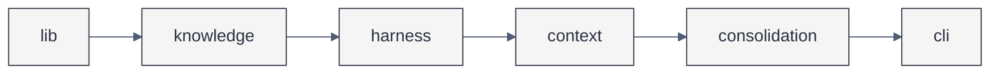
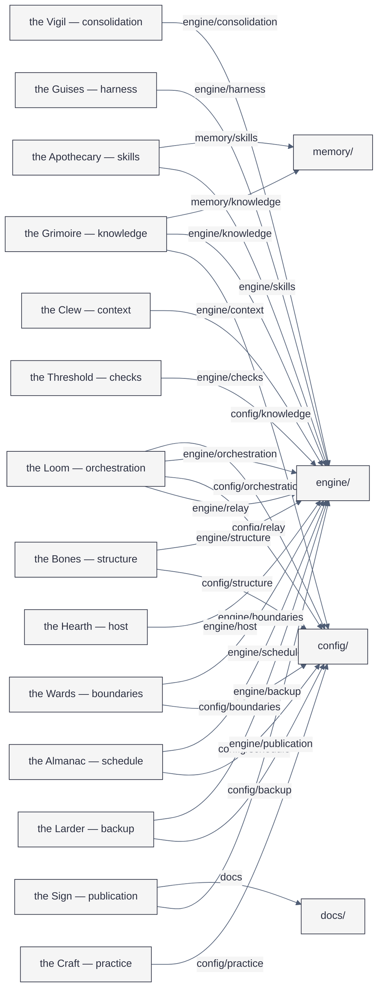
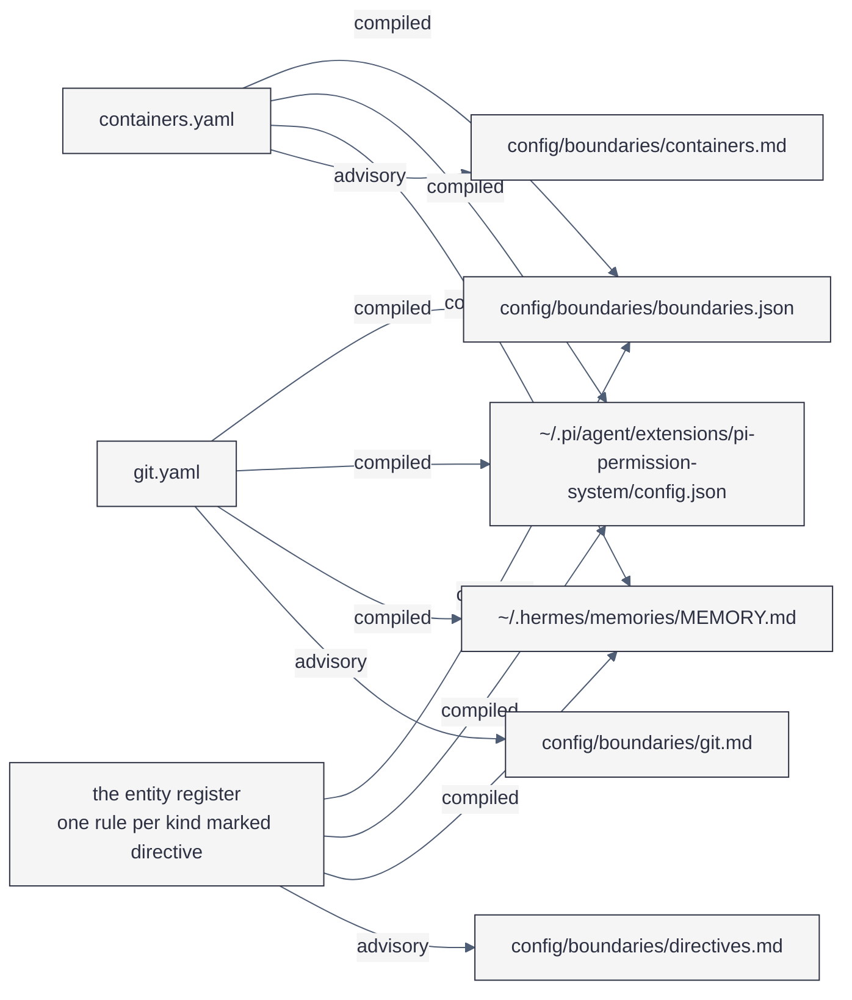

# Maps — where things are, drawn from what says so

Five figures, each generated from the register that already holds the relation:
the engine's package order, the subjects and the directories they occupy, the
boundaries and what they compile to, the schedule, and the pass's stages with
their declared invariants.

**Generated means never hand-edited.** The blocks below sit between
`BEGIN:`/`END:` markers and are rewritten by `familiar structure maps`, which
`pre-commit` runs with `--check`. The prose around them is hand-written and
kept. A figure that disagrees with its register is a stale block, and the check
says so.

Every figure names its source and its limit. A figure with no stated limit
teaches that the system is smaller than it is.

## The engine's package order

An import may only go left: `context` may import `knowledge`, and `knowledge`
may not import `context`. The gate is
[`checks/import_order.py`](../../engine/checks/import_order.py).

<!-- BEGIN:maps-import-order (generated) -->

<!-- END:maps-import-order -->

Source: `ORDER` in `engine/checks/import_order.py`. Limit: the order covers the
six packages that hold code. `engine/structure/` and `engine/host/` are shell and
generators, are not in the order, and are therefore not constrained by it.

## The subjects, and the directories they occupy

Each subject owns the directories it *occupies* — a rule with a gate behind it,
because a top-level directory claimed by no subject fails `ontology check`. The
register is [`config/knowledge/subjects.yaml`](../../config/knowledge/subjects.yaml).

<!-- BEGIN:maps-subjects (generated) -->

<!-- END:maps-subjects -->

Source: the `places:` of every subject in the register. Limit: what is drawn is
*ownership*, not access — a path a subject's code reads without occupying it (a
leaf under `memory/knowledge/`, for instance) is not an edge here.

## The boundaries, and what they compile to

One file per domain; every domain compiles into the merged rule list, and each
rule reaches the surfaces that can enforce or state it. What is enforced and what
is only advisory is the distinction [the Wards](../explanation/lore/boundaries.md)
turns on.

<!-- BEGIN:maps-boundaries (generated) -->

<!-- END:maps-boundaries -->

Source: the target constants in
[`engine/boundaries/compile.py`](../../engine/boundaries/compile.py) and
`_boundaries.py`, which are the paths the compiler writes. Limit: the figure
shows which domain reaches which target, not which *rules* are in it — read the
domain file, or `compile.py --explain <path>`, for that. Two conditions it cannot
show: the merged JSON and the Pi policy carry every domain's rules in one object
each, and the hermes block is written only when
`~/.hermes/memories/MEMORY.md` already exists — a machine without hermes gets
three targets, not four.

## The schedule

Every calendar-scheduled unit is rendered from one table in the master config;
[`schedule/timers-gen.sh`](../../engine/schedule/timers-gen.sh) writes the unit
pairs from it.

```mermaid
%%{init: {'theme': 'base', 'themeVariables': {'background': '#f5f5f5', 'primaryColor': '#f5f5f5', 'primaryTextColor': '#2d3142', 'primaryBorderColor': '#2d3142', 'secondaryColor': '#ececec', 'tertiaryColor': '#ececec', 'lineColor': '#4f5d75', 'textColor': '#2d3142', 'edgeLabelBackground': '#f5f5f5', 'clusterBkg': '#ececec', 'clusterBorder': '#bfc0c0', 'noteBkgColor': '#f5f5f5', 'fontFamily': 'Geist, Helvetica Neue, Arial'}}}%%
flowchart LR
  u_pazras_backup["pazras-backup<br/>PAZRAS restic backup — all configured paths"]
  u_pazras_sync["pazras-sync<br/>Push restic repo deltas to the configured remotes"]
  u_familiar_memory["familiar-memory<br/>Agent-memory consolidation — the nightly pass (9 stages)"]
  u_pazras_prune["pazras-prune<br/>PAZRAS restic retention and prune"]
  u_pazras_mirror["pazras-mirror<br/>Publish a browsable PAZRAS mirror to the off-site provider"]
  u_pazras_validate["pazras-validate<br/>PAZRAS configuration validation"]
  u_pazras_verify["pazras-verify<br/>PAZRAS restic integrity check"]
  u_pazras_reconcile["pazras-reconcile<br/>Reconcile remote restic copies with the local repo (dry-run — apply with backup reconcile --execute)"]
  u_familiar_highlights["familiar-highlights<br/>Send the nightly pass's highlights to the phone through the relay"]
  u_familiar_journal_index["familiar-journal-index<br/>Rebuild the local embedding index over journal/ (D4, incremental)"]
  u_claude_window["claude-window<br/>Open a Claude window on purpose — a 5-minute tick that pings Haiku when the last 5h window has ended (state-driven, no interval)"]
  u_familiar_dispatch["familiar-dispatch<br/>The scheduler's dispatcher — start the job that is due and whose conditions allow"]
  u_familiar_healthcheck_daily["familiar-healthcheck-daily<br/>Daily health check — drift, live state, last unit results (no network, no model)"]
  u_familiar_healthcheck["familiar-healthcheck<br/>Weekly health check — the daily tier plus the test suites, updates and the network"]
  u_familiar_healthcheck_monthly["familiar-healthcheck-monthly<br/>Monthly health check — the weekly tier plus the checks that drive each harness CLI"]
  u_familiar_scout["familiar-scout<br/>The model chart's weekly scout — nominate a model the chart moved, for the reader calibration to measure"]
  u_familiar_evals["familiar-evals<br/>The evaluation layer's weekly read — one batch of readings per measured component, no verdict"]
  u_pazras_backup -->|"*-*-* 00:00:00"| run_u_pazras_backup["06_SYSTEM/engine/familiar backup run"]
  u_pazras_sync -->|"*-*-* 04:30:00"| run_u_pazras_sync["06_SYSTEM/engine/familiar backup sync"]
  u_familiar_memory -->|"*-*-* 03:30:00"| run_u_familiar_memory["06_SYSTEM/engine/familiar consolidation run"]
  u_pazras_prune -->|"*-*-02 05:00:00"| run_u_pazras_prune["06_SYSTEM/engine/familiar backup prune"]
  u_pazras_mirror -->|"Sat *-*-* 02:00:00"| run_u_pazras_mirror["06_SYSTEM/engine/backup/mirror.sh"]
  u_pazras_validate -->|"Sun *-*-* 09:00:00"| run_u_pazras_validate["06_SYSTEM/engine/familiar structure validate"]
  u_pazras_verify -->|"*-*-01 05:00:00"| run_u_pazras_verify["06_SYSTEM/engine/familiar backup verify 5%%"]
  u_pazras_reconcile -->|"*-01,04,07,10-05 06:00:00"| run_u_pazras_reconcile["06_SYSTEM/engine/familiar backup reconcile"]
  u_familiar_highlights -->|"*-*-* 06:00:00"| run_u_familiar_highlights["06_SYSTEM/engine/familiar consolidation brief --highlights --send"]
  u_familiar_journal_index -->|"*-*-* 06:15:00"| run_u_familiar_journal_index["06_SYSTEM/engine/familiar knowledge journal index"]
  u_claude_window -->|"*:0/5"| run_u_claude_window["06_SYSTEM/engine/familiar orchestration ping"]
  u_familiar_dispatch -->|"*:0/5"| run_u_familiar_dispatch["06_SYSTEM/engine/familiar schedule sessions tick"]
  u_familiar_healthcheck_daily -->|"*-*-* 06:45:00"| run_u_familiar_healthcheck_daily["06_SYSTEM/engine/familiar checks healthcheck --tier daily"]
  u_familiar_healthcheck -->|"Wed *-*-* 07:00:00"| run_u_familiar_healthcheck["06_SYSTEM/engine/familiar checks healthcheck --tier weekly"]
  u_familiar_healthcheck_monthly -->|"*-*-03 07:30:00"| run_u_familiar_healthcheck_monthly["06_SYSTEM/engine/familiar checks healthcheck --tier monthly"]
  u_familiar_scout -->|"Mon *-*-* 07:30:00"| run_u_familiar_scout["06_SYSTEM/engine/familiar orchestration scout --check"]
  u_familiar_evals -->|"Mon *-*-* 08:00:00"| run_u_familiar_evals["06_SYSTEM/engine/familiar checks evals read"]
```

<!-- BEGIN:maps-schedule (generated) -->

<!-- END:maps-schedule -->

Source: `PAZRAS_TIMERS` in `config/structure/pazras-master-config.example.sh`.
Limit: event-triggered units are not calendar-scheduled and are absent by
construction — the archive flush is one.

## The pass: stages and their invariants

The consolidation pass is a list of stages, and every stage declares what it
guarantees. `idem` is idempotence, `disj` disjointness, `dir` directionality;
`n/a` means the invariant has no content for that stage, and a status of `owed`
is a claim the stage does not yet meet.

```mermaid
%%{init: {'theme': 'base', 'themeVariables': {'background': '#f5f5f5', 'primaryColor': '#f5f5f5', 'primaryTextColor': '#2d3142', 'primaryBorderColor': '#2d3142', 'secondaryColor': '#ececec', 'tertiaryColor': '#ececec', 'lineColor': '#4f5d75', 'textColor': '#2d3142', 'edgeLabelBackground': '#f5f5f5', 'clusterBkg': '#ececec', 'clusterBorder': '#bfc0c0', 'noteBkgColor': '#f5f5f5', 'fontFamily': 'Geist, Helvetica Neue, Arial'}}}%%
flowchart LR
  st_replay["1 · replay<br/>shape: ctx-write<br/>idem: elsewhere · disj: n/a · dir: n/a"]
  st_aggregate["2 · aggregate<br/>shape: ctx-write<br/>idem: held · disj: n/a · dir: n/a"]
  st_replay --> st_aggregate
  st_score["3 · score<br/>shape: proposal-only<br/>idem: n/a · disj: n/a · dir: n/a"]
  st_aggregate --> st_score
  st_consolidate["4 · consolidate<br/>shape: proposal-only<br/>idem: n/a · disj: n/a · dir: owed"]
  st_score --> st_consolidate
  st_associate["5 · associate<br/>shape: ctx-write<br/>idem: held · disj: n/a · dir: n/a"]
  st_consolidate --> st_associate
  st_conflicts["5 · conflicts<br/>shape: plan/apply<br/>idem: held · disj: held · dir: held"]
  st_associate --> st_conflicts
  st_downscale["6 · downscale<br/>shape: proposal-only<br/>idem: n/a · disj: n/a · dir: n/a"]
  st_conflicts --> st_downscale
  st_label["6 · label<br/>shape: proposal-only<br/>idem: n/a · disj: n/a · dir: n/a"]
  st_downscale --> st_label
  st_bindings["6 · bindings<br/>shape: proposal-only<br/>idem: n/a · disj: n/a · dir: n/a"]
  st_label --> st_bindings
  st_reindex["7 · reindex<br/>shape: plan/apply<br/>idem: held · disj: held · dir: n/a"]
  st_bindings --> st_reindex
  st_knowledge_index["7 · knowledge-index<br/>shape: plan/apply<br/>idem: held · disj: held · dir: n/a"]
  st_reindex --> st_knowledge_index
```

<!-- BEGIN:maps-stages (generated) -->

<!-- END:maps-stages -->

Source: `STAGES` in `engine/consolidation/run.py` and `DECLARED` in
`engine/consolidation/stages/invariants.py`. Limit: two stage ids carry two
stages each — `5` has `associate` and `conflicts`, `6` has `downscale` and
`label` — and the chain above is the run order, which is the list's order.

## The figures that are not generated

Three figures have no register to be drawn from: the PARA filing decision, the
authority boundary, and displacement in the memory tiers. Each is hand-written in
[the architecture page](../explanation/architecture.md), and each of its nodes
declares the path or folder it stands for, which `familiar structure maps
--check` verifies. A figure about where a thought goes cannot be generated from
a register, but it can be made to point at something real.
