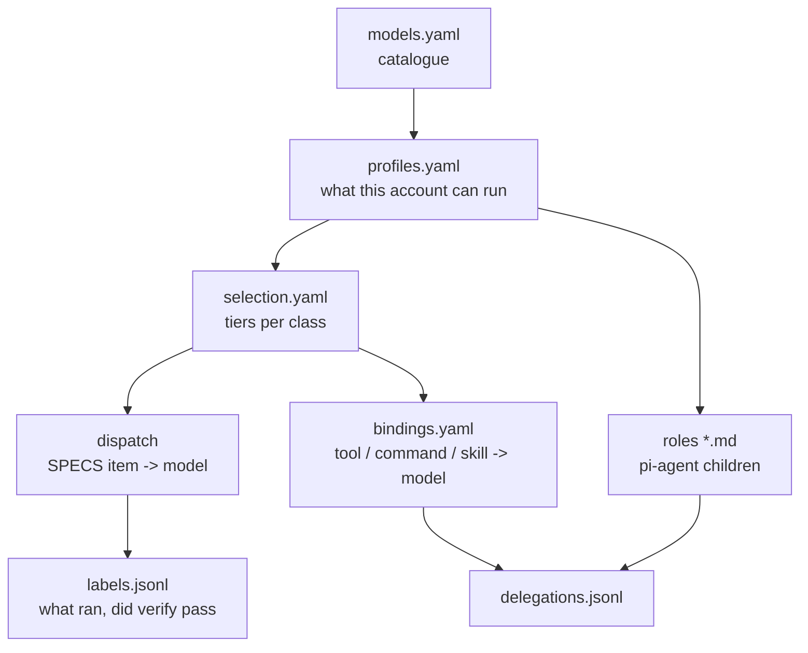

# The Loom — how work is assigned to a model

**One question, three granularities: who does this?** A `SPECS.md` item is
answered at planning, a tool call or a command by a binding, and a bulk read by
a role a child runs. All three draw from one catalogue, filtered by one
profile, and each answer is a catalogue id, never a provider string. Whether
this pays is the verdict in [[orchestrators]].

## The pieces

| piece | file | what it decides | check |
|---|---|---|---|
| catalogue | `config/orchestration/models.yaml`, `capabilities.yaml` | every callable model: price, context, egress, privacy, effort levels, benchmark keys; stale after 60 days | `familiar orchestration models --check` |
| profile | `profiles.yaml` | which vendors this pi process can reach (`PI_PROFILE`, default `private`); a vendor without a key is unavailable, never borrowed | resolved inside every command |
| tiers | `selection.yaml` | per class (`read edit test docs batch unknown`), ordered tiers of *adequate* models, each with an effort level; the cheapest available member runs | `familiar orchestration selection --check` |
| contract | `specs.yaml` | the four item fields: `touches:`, `depends:`, `model:`, `verify:` | `familiar orchestration dispatch --check <SPECS.md>`, and the `specs-dispatchable` gate |
| dispatch | `dispatch.yaml` + Jev probes | the waves (`depends:` sorted, overlapping `touches:` split), and an audit of each declared `model:` | `familiar orchestration dispatch <SPECS.md>` |
| **the routing point** | — | Jev runs **once per `SPECS.md`, at the switch from planning to implementation**, never per prompt: it extracts an item's class and difficulty, which picks the tier | `familiar orchestration dispatch <SPECS.md>` prints declared vs suggested |
| bindings | `bindings.yaml` | `tool:` `command:` `skill:` → a model, with a contract the child must return and a declared fallback chain | `familiar orchestration bindings --check` |
| roles | `explore.md research.md review.md bash.md` | the read-only children `pi-agent <role> "<task>"` runs | `pi-agent --list -v` |
| labels | `engine/orchestration/labels.py` | per item: declared, suggested and ran model, tokens, first-try pass | `familiar orchestration labels --report` |

## Rules that hold across the pieces

- **Selection is policy, not a score gate** (decision 27). The cheapest member
  of the applicable tier runs. A missing benchmark never disqualifies. A probe
  may select a higher tier; scope may only remove candidates.
- **An unavailable model is covered by a declared chain**: `default:` then
  `fallbacks:` on a binding, `fallback:` on an item. The swap is printed;
  nothing is swapped silently.
- **Effort is the first dial** (decision 28). A level is declared where the
  model is declared: role frontmatter, tier entry, binding. A level the model
  does not support is a `--check` finding, refused and never clamped
  (`qwen3:4b` is `thinking: no`).
- **Escalation is a re-dispatch with context**, never a hot model switch.
  After two failures of `familiar orchestration verify … --class <c> --effort
  <e>` on one model and effort, the wrapper prints the next step:
  1. one effort level up, once per model, and only to a level the catalogue
     lists;
  2. then the cheapest model of the next tier;
  3. then `STOP`, and the user decides.
  It advises; it does not re-run anything (`engine/orchestration/escalation.py`).
- **A binding delegates and never switches the parent's model**, so the
  parent's prompt cache survives. The child returns something checkable:
  `ref+quote` (`path:line "quote"`), `extract+url`, or `command+exit`. `run`
  checks every quote against its file and exits 4 when the contract breaks.
  A document (`.pdf`, `.docx`, ...) is cited by its converted copy under
  `~/.cache/pazras/convert/`, which `read` names ([[pi]]); the checker accepts
  the absolute path.
- **Bound tools are off by default** (`PI_BINDINGS=1` turns them on), because
  each costs its schema in every parent session. The eval rejected them as
  tested ([[orchestrators]]).

## Commands

| command | does |
|---|---|
| `familiar orchestration dispatch --check <SPECS.md>` | refuses an item missing a field, an unknown model, a bad dependency |
| `familiar orchestration dispatch <SPECS.md>` | waves, plus each item's declared vs suggested model |
| `familiar orchestration verify <SPECS.md> <id>` | runs the item's own `verify:` and writes a label with the attempt number; refuses a `manual:` verify |
| `familiar orchestration labels [--seed-eval] [--report]` | the label distribution; thresholds stay advisory below 30 own-verdict items |
| `familiar orchestration bindings --resolve <on>` / `run <on> <task>` | which model a binding picks, and running it under its contract |
| `familiar orchestration selection --check` / `models --check` | the tiers and the catalogue hold |
| `pi-agent <role> "<task>" [--model id] [--effort level] [--session h]` | one child; it logs to `delegations.jsonl` ([[delegation-and-asks]]) |
| `familiar orchestration ping [--last N \| --audit [H] \| --print \| --force]` | the Claude window keeper: `claude-window.timer` ticks every 5 min, `ping` pings Haiku only when no 5 h window is running ([[#The window ping]]) |

`pi-agent` is `engine/orchestration/pi-agent`; the dotfiles hold a symlink so
it stays on `PATH`.

## The window ping

The Claude quota has two windows. The **5-hour** one opens on the first call after
the previous one ended and closes 5 h later; the **weekly** one resets at a fixed
time (Sun 04:00) and nothing opens it early. `omarchy-agent-usage-claude
--limits-only` reports both with a `resetsAt` (empty when no 5 h window runs).

`claude-window.timer` fires every 5 min (`OnCalendar=*:0/5`). `ping` keeps
`<PAZRAS_DATA_DIR>/claude-window-state.json` and acts like this:

| state | does | next check |
|---|---|---|
| `next_check` in the future | nothing, no network, no output | — |
| weekly ≥ 0.995 | no call (none can work) | weekly reset + 2 min |
| a 5 h window runs | no call | its end + 2 min |
| none runs | one `pong` to Haiku, then a forced re-probe | the new window's end + 2 min |
| an end past the window's own length (5 h, a week) | the reading is a broken probe: ignored, so the tick pings | as if no window ran, and the log row carries the reason |
| timeout, unrecognised failure, probe down | **unknown**, not closed | +5, 10, 20, 30 min; the 4th in a row exits 1 |

Model calls: about 5 a day. A fixed interval cannot do this: `CLOCK_MONOTONIC`
stops in suspend, a reboot re-arms `OnActiveSec`, and an extra start re-phases
`OnUnitActiveSec` (11 of 24 intervals were off in the 2026-10-20..25 journal).
The quota gate of `profiles.resolve` is bypassed (`ping.serve`): the fuller of
the two windows at 0.98 refused the 00:56 ping of 2026-10-25 with exit 2.

**Verify:** `familiar orchestration ping --audit` lists every ping of the last
24 h with its lag behind the window end it followed; `ok` is at most 10 min. The
journal shows one `ping:` line per decision. The log is
`<PAZRAS_DATA_DIR>/claude-window.jsonl` (`--last N`); a half-written line is
skipped and counted, never a reason for the audit to fail. Plan: SPECS item 15c.

## Labels — what the thresholds wait for

A label is per **item** (decision of 2026-10-15). Two sources write the same
row to `<PAZRAS_DATA_DIR>/labels.jsonl`:

- **the eval seed**, 21 labels from the coding cells. A multi-item step shares
  one verifier, so its labels are marked `verdict: shared` and count for cost
  only.
- **the verify wrapper**, for live work.

Until 30 items carry their own verdict, Jev's suggestion never overrides a
declared model, and `models.yaml` carries no measured `pass_rate`.

## Limits

- **A role's read-only-ness is its instructions plus the harness boundaries**,
  not a sandbox: `bash.md` has the `bash` tool.
- **A route** (`model: route` on `tool:explore`) asks Jev once per call, and
  falls back to `default:` below `route_confident_at` (0.8, a placeholder).
- **`docs` and `batch` have no benchmark** in the catalogue, so their tiers are
  asserted, not measured.
